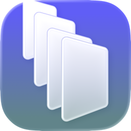
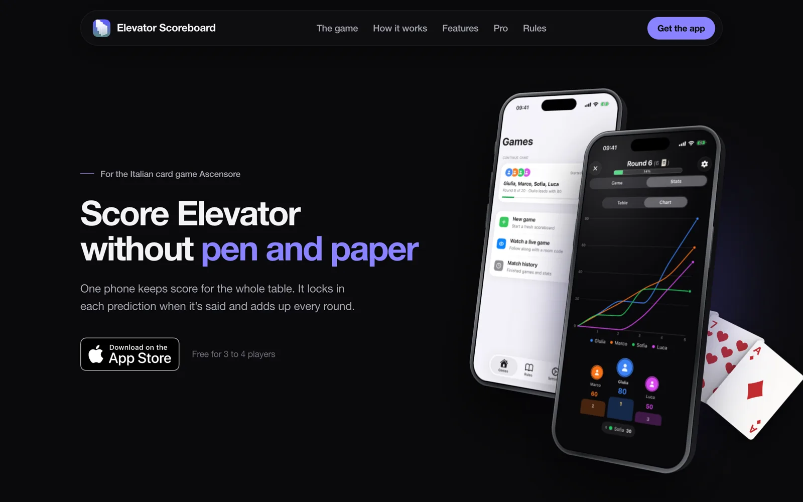
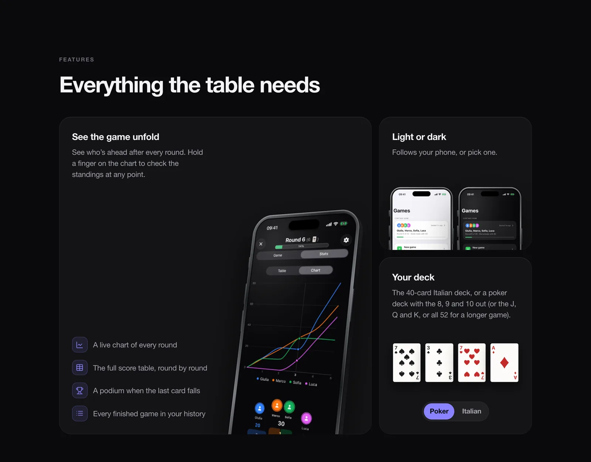
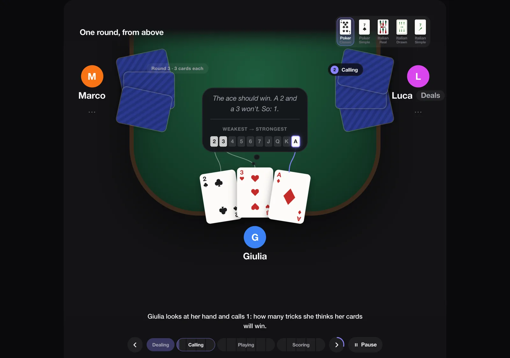
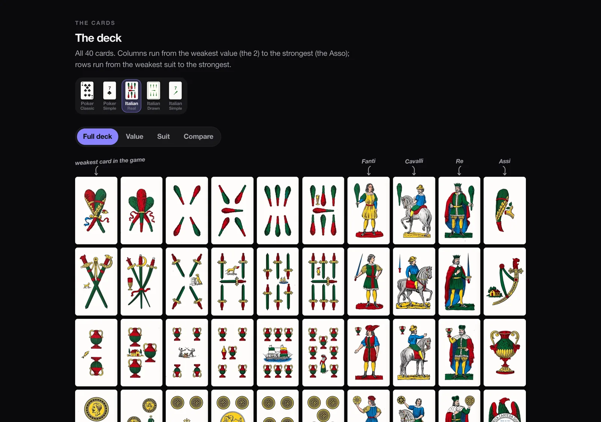

<p align="center">
  
</p>

<h1 align="center">Elevator Scoreboard</h1>

<p align="center">
  The website for Elevator Scoreboard, an iPhone scoreboard for the Italian card game Ascensore.<br />
  Live at <a href="https://elevator.lucapulv.com">elevator.lucapulv.com</a>
</p>



## What's on it

**The homepage** shows the app with real recordings from it: the chart, landscape focus mode, the Lock Screen Live Activity, and a room code typed in to follow a game live.



**[/rules](https://elevator.lucapulv.com/rules)** teaches the game. One round plays out on a table seen from above (deal, calls, play, scoring), with a timeline you can scrub and pause.



Below it is every card in the deck, in order, in five styles: two poker decks and three Italian ones, including a real Sicilian deck photographed card by card.



**[/story](https://elevator.lucapulv.com/story)** is how it started: a page on my portfolio in August 2024, and later the iPhone app.

There's also [/support](https://elevator.lucapulv.com/support) and [/privacy](https://elevator.lucapulv.com/privacy), which the App Store listing links to.

## Running it

```bash
bun install
bun dev
```

Then open [localhost:3000](http://localhost:3000). `bun run build` and `bun run lint` should pass before anything goes to `main`, which deploys to Vercel.

To run a second dev server next to the first, give it its own build folder:

```bash
NEXT_DIST_DIR=.next-b bunx next dev -p 3101
```

## How it's built

Next.js 16 (app router, every page static), React 19, Tailwind CSS v4 and Framer Motion. The animations on the rules page are plain CSS and the Web Animations API. Analytics are Vercel Analytics and PostHog, proxied through `/ingest`.

| Where | What |
|---|---|
| `app/page.tsx` | The homepage |
| `app/rules/` | The rules page. The round is `components/RoundDemo.tsx`, the deck is `components/DeckGrid.tsx` |
| `app/story/` | The story page |
| `app/lib/site.ts` | Domain, contact email and store links |
| `public/clips/`, `public/screenshots/` | Recordings and screenshots from the app |
| `public/cards/` | Card art for every deck style |
| `scripts/clips/` | `bun run clips` re-records the app clips from a dev build in the Simulator (needs Maestro and ffmpeg) |
| `scripts/cards/` | Builds the card art |

---

Made by [Luca Pulvirenti](https://lucapulv.com).
